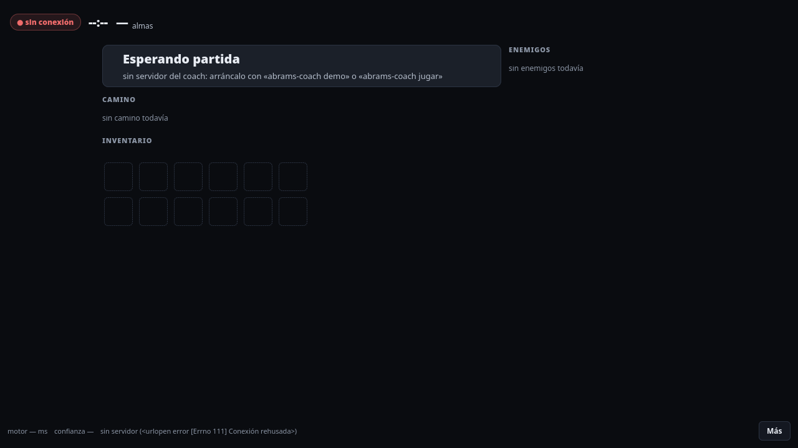

<div align="center">

# Abrams Coach

**Coach de segundo monitor para Deadlock.** Lee tu HUD de la pantalla, decide qué comprar ahora y te dice al terminar qué regla te costó la partida.

[](https://github.com/DiegoCraft26/abrams-coach/actions/workflows/ci.yml)
[](CHANGELOG.md)
[](LICENSE)
[](https://www.python.org/)
[](#plataforma)

[English](README.md) · [Docs](docs/) · [Hoja de ruta](ROADMAP.md) · [Cambios](CHANGELOG.md)

</div>



<sub>Modo demo (`abrams-coach demo`) con datos de ejemplo. El panel es el mismo que ves en partida: la cabecera dice «en vivo» o «pantalla» y las almas de los rivales llegan del broadcast.</sub>

## Qué es

- **Lee tu pantalla, no el juego.** La captura va por KWin (D-Bus) y OCR. Sin leer memoria, sin inyectar, sin hooks, sin macros y sin overlay dentro de Deadlock.
- **Dice el siguiente paso**, no una nota: un camino de build con `COMPRAR / AHORRAR / VENDER`, cuánto falta y un ETA en segundos.
- **Avisa a las seis muertes**, que es una de las dos reglas con efecto demostrado en ganar.
- **Escribe la nota post-partida:** qué regla se te fue, con la población que la sostiene y tu propio histórico.
- **Vive en un segundo monitor o en el navegador** (`http://127.0.0.1:8090/panel`), y al cerrarla no deja nada corriendo.

## Arranque rápido

```bash
git clone https://github.com/DiegoCraft26/abrams-coach.git
cd abrams-coach
./instalar.sh          # comprueba dependencias, sin sudo ni instalar paquetes
abrams-coach demo      # panel con datos de ejemplo, sin abrir el juego
abrams-coach listo     # chequeo previo: cuenta, red, captura, overlay, puerto, disco
abrams-coach jugar     # abre el coach y el panel para una partida real
```

`abrams-coach ayuda` imprime el ciclo completo en una pantalla: `listo` → `plan` → `jugar` → `nota` → `sesion`.

## Qué te dice

| Sección | Contenido |
|---|---|
| Cabecera | reloj, oro sin gastar, patrimonio, ventaja de almas y estado táctico |
| Compra | el siguiente paso del build con `COMPRAR / AHORRAR / VENDER`, cuánto falta y ETA |
| Inventario | tus 12 slots y el rendimiento de cada ítem frente a lo esperado |
| Enemigos | almas y KDA de los cinco rivales |
| Plan | las compras que suelen seguir, del grafo de partidas públicas |
| Contra su composición | ítems que la amenaza enemiga justifica, con su fuente |
| Ventas | cuándo vender rinde más que seguir ahorrando |
| Pie | latencia real de cada eslabón |

## Cómo funciona

1. **Captura** con KWin por D-Bus y reutiliza el último cuadro entre lectores.
2. **Lee** reloj, oro e id de partida del HUD con OCR; el marcador, con plantillas del propio juego.
3. **Engancha** el broadcast público por `deadlock-api`, con el id del HUD o tu cuenta.
4. **Decide** siguiendo un camino de build: tres aperturas de 800, tres piezas de core (1,600–3,200) y los spikes.
5. **Publica** el estado en `127.0.0.1:8090`; lo consumen el panel nativo y el panel web.
6. **Consulta** lo que ya sabe: tus partidas para el camino y un archivo local de partidas públicas para las composiciones.

Detalle técnico: [`docs/ARQUITECTURA.md`](docs/ARQUITECTURA.md) · Qué hace y qué no con el juego: [`POLITICA.md`](POLITICA.md).

## Medido, no supuesto

Lo que distingue al proyecto es lo que **se niega** a afirmar. Dos reglas tienen efecto demostrado; todo lo demás se informa como lo que es.

| Afirmación | Evidencia | Estado |
|---|---|---|
| Seis muertes o menos gana más | 76,9 % vs 36,2 % en 3 538 partidas | **se usa** |
| 0,40 de participación o más gana más | 70,9 % vs 12,8 % en 3 538 partidas | **se usa** |
| El ítem de 3 200 es una meta | 55,1 % vs 53,0 % (p=0,20) en 3 935 jugador-partida | se informa, no se propone |
| Ranking de ítems por «valor medido» | 63 680 compras en 20 parches, ningún ítem replicó | **apagado** — resultado negativo |
| Almas del rival por broadcast | llega 20–25 s tarde, se muestra con su edad | se muestra, nunca se disimula |

Informes: [`docs/MOTOR-V2.md`](docs/MOTOR-V2.md) · [`docs/VALIDACION.md`](docs/VALIDACION.md)

## Uso de deadlock-api

El coach es un cliente bien portado de la [API pública](https://deadlock-api.com). Qué pide y cómo se queda dentro:

| Llamada | Cupo | Cómo lo respeta |
|---|---|---|
| `GET /v1/matches/{id}/live/url` (espectar **tu** partida) | 6/hora por IP | una llamada por partida, URL cacheada 1 h y balde local que corta *antes* de gastar |
| `GET /v1/matches/live/urls` (listado de emisiones) | ilimitado | se refresca cada 30 s; las partidas listadas se resuelven **gratis** |
| `GET /v1/analytics/*` | 200/minuto por IP | caché en disco de 24 h, techo propio de 120 peticiones/hora |
| `GET /v1/assets/*` | gratis | caché de 24 h |
| `POST /v1/matches/demo/query` | 200/hora por IP | balde propio de 170/h y sondeo cada 5–15 s |

Todas las peticiones llevan un único `User-Agent` con enlace de contacto, para que sus operadores distingan nuestro tráfico del ruido.

## Plataforma

| Sistema | Estado |
|---|---|
| KDE Plasma 6 + Wayland | **probado** (entorno de desarrollo) |
| KDE Plasma + X11 | sin probar; la captura usa KWin por D-Bus y debería funcionar |
| GNOME / otro escritorio | **no funciona**: no hay KWin ni `org.kde.KWin.ScreenShot2` |
| Windows | overlay y captura corren bajo Wine (10 comprobaciones, GDI a 27,7 ms); nativo todavía no |

El requisito de KDE es real, no una preferencia: la captura va por `org.kde.KWin.ScreenShot2` (~40 ms por cuadro, sin tirones) y `spectacle` de respaldo.

## Requisitos

Python 3.11 o más, GTK 4 con PyGObject, Pillow, NumPy, PyYAML, `tesseract` y `spectacle`.

```bash
# Arch / CachyOS / Manjaro (probado)
sudo pacman -S --needed python-gobject gtk4 tesseract spectacle python-pillow python-numpy python-yaml

# Debian / Ubuntu
sudo apt install python3-gi gir1.2-gtk-4.0 libgtk-4-1 tesseract-ocr spectacle python3-pil python3-numpy python3-yaml
```

El arte del juego no se distribuye: en el primer arranque la app baja ~9 MB de iconos del bucket público de `deadlock-api` a `data/iconos/` (ignorado por git). Código bajo MIT; Deadlock es una marca de Valve y este proyecto no está afiliado ni respaldado por Valve.

## Detalles de uso

### La cuenta es opcional

- **Sin cuenta**: la app lee `MATCH: …` del HUD y engancha el broadcast de esa partida. Funciona en cualquier ranked, práctica o bots, sin pedir el SteamID. Con `--mi-heroe abrams` intenta saber cuál jugador eres; si hay dos Abrams, no adivina y lo dice.
- **Con cuenta**: `abrams-coach jugar` la lee de `.cuenta` (ignorado por git), de `ABRAMS_CUENTA` o de `--cuenta`. Así sabe qué columna es la tuya y avisa si tu cuenta no está en la partida.

Nunca hay una cuenta de fábrica en el código.

### Abrirla sin pensar

- `abrams-coach abrir` abre coach y panel ahora, en el monitor secundario. La app vive mientras viva su ventana; `ABRAMS_QUEDAR=1` la deja corriendo.
- `abrams-coach esperar` se queda en segundo plano y hace lo mismo **cuando abres Deadlock**; al salir archiva la partida. `instalar.sh` puede dejarlo al iniciar sesión.
- Atajo global: Ajustes → Atajos → comando → `abrams-coach abrir`. Funciona con el juego en primer plano porque lo captura KWin, no el juego.
- No hay botón **dentro** del juego: el proyecto no dibuja ni inyecta nada.
- `touch ~/.abrams-silencio` deja el vigilante esperando pero sin abrir el panel; `rm` lo devuelve.

### Panel web

```bash
python3 run.py --fuente vivo --puerto 8090
# abre http://127.0.0.1:8090/panel  (o http://<tu-ip>:8090/panel desde otro equipo)
```

Mismo dato que la app nativa, sin instalar nada y sin dependencias externas. `capturas/panel-web.png`.

### ¿La app abierta es la última?

El panel no se recarga en caliente: si editas código con la app abierta, sigue mostrando lo viejo sin avisar.

```bash
python3 herramientas/version.py              # 0 si está al día, 2 si quedó atrás
curl -s http://127.0.0.1:8090/api/version    # con la app corriendo
```

## Límites conocidos

- **El contador de almas del HUD no se publica**: `tesseract` no acierta con la fuente del juego y falta el banco de plantillas propio. El reloj y el id sí se leen.
- El broadcast llega 20–25 s tarde. Se muestra con su edad.
- **La puntuación de economía es solo de Abrams**: el camino y los contras salen de sus 626 partidas. Para otro héroe el panel da su apertura y lo dice en la cabecera.
- La interfaz está en español; este README es la versión bilingüe.
- La calibración del HUD depende de resolución y parche; hay un calibrador.
- El marcador solo se lee con Tab abierto.
- Probar la lectura real necesita tus propias capturas en `verdad/`; sin ellas esas pruebas se saltan y lo dicen.

## Docs

| | |
|---|---|
| [`docs/GUIA.md`](docs/GUIA.md) | guía de uso |
| [`docs/ARQUITECTURA.md`](docs/ARQUITECTURA.md) | cómo encajan las piezas |
| [`docs/USO-DIARIO.md`](docs/USO-DIARIO.md) | el ciclo diario |
| [`docs/DATOS-DEL-JUEGO.md`](docs/DATOS-DEL-JUEGO.md) | qué expone el juego y qué no |
| [`docs/WINDOWS.md`](docs/WINDOWS.md) | el camino de Wine |
| [`ROADMAP.md`](ROADMAP.md) | lo que viene y lo que no |
| [`CONTRIBUTING.md`](CONTRIBUTING.md) | cómo correr las pruebas |

## Desarrollo

```bash
python3 -m compileall -q coach herramientas tests run.py panel_nativo.py
python3 -m pytest -q
python3 coach/iconos.py                                   # baja el arte (una vez)
python3 herramientas/validar_camino.py --cache data/replay_muestra.json --partidas 60
```

La CI corre en Ubuntu 24.04 con GTK bajo Xvfb, en Python 3.12 y 3.13: baja los iconos, ejecuta la suite completa y la puerta de pintado de la UI. En local: 510+ pruebas, y las que necesitan datos locales lo dicen en vez de fallar en silencio.

## Privacidad

Solo píxeles. Sin memoria del proceso, sin inyección, sin macros, sin telemetría. Las capturas y la base de partidas se quedan en tu máquina (`salida/`, `datos/`). A la API solo le llega un id de partida o tu SteamID64.
