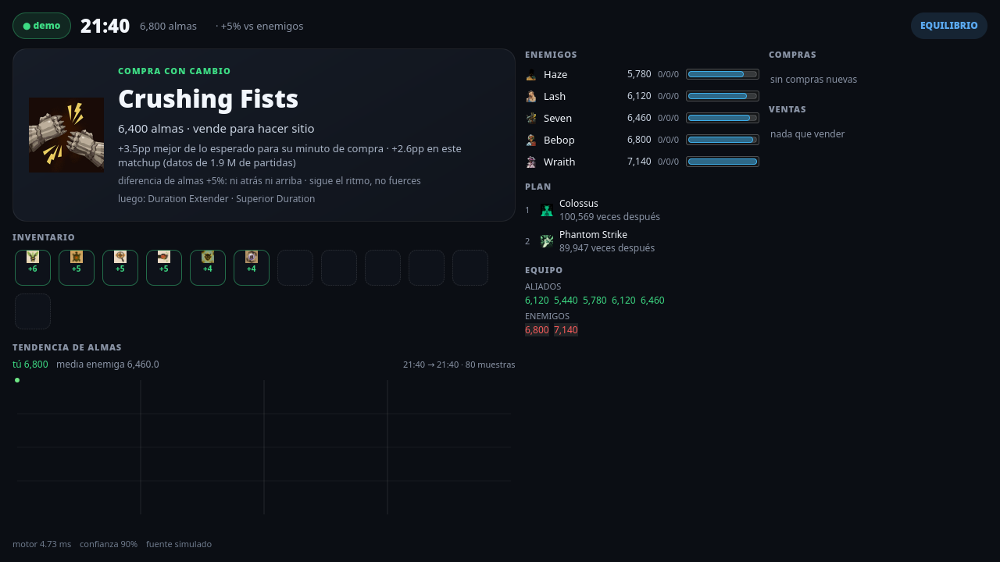

# Abrams Coach

Panel de decisiones para Deadlock. Lee tu partida desde la pantalla (HUD y marcador) y,
cuando hay broadcast público, desde la API de espectador. Te dice qué comprar, cuándo
ahorrar, cuándo vender y si el oro alcanza. Vive en un segundo monitor: **no dibuja nada
encima del juego, no lee memoria y no inyecta nada**.

Estado: **v0.2**, solo Abrams, interfaz en español.



## Plataforma

| Sistema | Estado |
|---|---|
| KDE Plasma 6 + Wayland | **probado** (es el entorno de desarrollo) |
| KDE Plasma + X11 | sin probar; la captura usa KWin por D-Bus, debería funcionar |
| GNOME / otro escritorio | **no funciona**: no hay KWin ni `org.kde.KWin.ScreenShot2` |
| Windows / macOS | no |

La captura va por `org.kde.KWin.ScreenShot2` (unos 40 ms por cuadro, sin tirones) y
`spectacle` como respaldo. Por eso el requisito de KDE es real, no una preferencia.

## Requisitos

Python 3.11 o más, GTK 4 con PyGObject, Pillow, NumPy, PyYAML, `tesseract` y `spectacle`.

**Arch / CachyOS / Manjaro** (probado):

```bash
sudo pacman -S --needed python-gobject gtk4 tesseract spectacle \
                       python-pillow python-numpy python-yaml
```

**Debian / Ubuntu**:

```bash
sudo apt install python3-gi gir1.2-gtk-4.0 libgtk-4-1 tesseract-ocr spectacle \
                 python3-pil python3-numpy python3-yaml
```

**Fedora** (nombres equivalentes, sin probar):

```bash
sudo dnf install python3-gobject gtk4 tesseract spectacle \
                 python3-pillow python3-numpy python3-pyyaml
```

## Instalación

```bash
git clone https://github.com/DiegoCraft26/abrams-coach.git
cd abrams-coach
./instalar.sh
abrams-coach demo
```

`instalar.sh` comprueba las dependencias, dice cuál falta y deja `abrams-coach` en
`~/.local/bin`. No instala paquetes ni usa `sudo`.

El arte del juego no viene en el repo: la primera vez que arranca, la app baja unos
9 MB de iconos del bucket público de `deadlock-api` a `data/iconos/` (ignorado por git).

### La cuenta es opcional

Para el modo en vivo hay dos caminos:

- **Sin cuenta**: la app lee `MATCH: …` del HUD y engancha el broadcast de esa partida.
  Funciona en cualquier ranked, práctica o bots, sin pedirte el SteamID. Con
  `--mi-heroe abrams` intenta saber cuál jugador eres; si hay dos Abrams en la partida,
  no adivina y te lo dice.
- **Con cuenta**: `abrams-coach jugar` la lee de `.cuenta` (ignorado por git), de
  `ABRAMS_CUENTA` o de `--cuenta`. Así sabe sin ambigüedad qué columna es la tuya y
  puede avisar si tu cuenta no está en la partida.

Nunca hay una cuenta de fábrica en el código.

## Uso

```bash
abrams-coach demo       # panel con datos de ejemplo, sin abrir el juego
abrams-coach jugar      # prepara la máquina, abre coach y panel
abrams-coach esperar    # arranca solo cuando abres Deadlock y archiva al salir
abrams-coach estado     # qué corre, cuánta RAM usa, qué leyó
abrams-coach archivar   # guarda la sesión en la base local
abrams-coach informe    # resumen de la última partida
abrams-coach medir      # mide la cadena de latencia
abrams-coach parar      # cierra todo
```

Sin instalador:

```bash
./arrancar.sh simulado && python3 panel_nativo.py
python3 run.py --fuente vivo                    # HUD, sin cuenta
python3 run.py --fuente vivo --cuenta TU_ID     # broadcast identificado
```

Atajos del panel: `1` compra, `2` enemigos, `3` compras, `?` ayuda, `Esc` cerrar. La
ventana recuerda tamaño y posición.

## Qué te dice

| Sección | Contenido |
|---|---|
| Cabecera | reloj, oro sin gastar, patrimonio, ventaja de almas y estado táctico |
| Compra | un ítem, con sus razones y lo que falta si no alcanza |
| Inventario | tus 12 slots y el rendimiento de cada ítem frente a lo esperado |
| Enemigos | almas y KDA de los cinco rivales |
| Plan | las compras que suelen seguir, del grafo de partidas públicas |
| Contra su composición | ítems que la amenaza enemiga justifica, con su fuente |
| Ventas | cuándo vender rinde más que seguir ahorrando |
| Pie | latencia real de cada eslabón |

## Cómo funciona

1. **Captura** la pantalla con KWin (D-Bus) y reutiliza el último cuadro entre lectores.
2. **Lee** el reloj, el oro y el id de partida del HUD con OCR; el marcador, con
   plantillas del propio juego. Nada de memoria del proceso.
3. **Engancha** el broadcast público por `deadlock-api` usando el id del HUD o tu cuenta.
4. **Decide** con un motor que ordena ítems por *lift residual* y respeta lo que puedes
   pagar; no recomienda lo que no alcanza.
5. **Publica** el estado en `http://127.0.0.1:8090`; el panel nativo lo consume.

Detalle técnico: [`docs/ARQUITECTURA.md`](docs/ARQUITECTURA.md).
Qué hace y qué no hace con el juego: [`POLITICA.md`](POLITICA.md).
Qué viene: [`ROADMAP.md`](ROADMAP.md).

## Privacidad

- Solo lee píxeles de tu pantalla. No abre el proceso del juego, no lee memoria, no
  inyecta, no usa overlays ni macros.
- Las capturas y la base de partidas se quedan en tu máquina (`salida/`, `datos/`).
- Al API pública solo se le pide el id de partida o tu SteamID64; no se sube nada.
- La app no tiene telemetría.

## Límites conocidos

- **El contador de almas del HUD no se publica**: `tesseract` no acierta con la fuente
  del juego (0 de 12 configuraciones) y falta el banco de plantillas propio. El reloj y
  el id sí se leen.
- El broadcast llega 20–25 s tarde. Se muestra con su edad; no se disimula.
- Solo Abrams y solo español. Multi-héroe está en el roadmap.
- La calibración del HUD depende de la resolución y del parche; hay un calibrador.
- El marcador solo se lee con Tab abierto.
- Probar la lectura real necesita tus propias capturas en `verdad/`; sin ellas, esas
  pruebas se saltan y lo dicen.

## Desarrollo

```bash
python3 -m compileall -q coach herramientas tests run.py panel_nativo.py
python3 -m pytest -q
python3 coach/iconos.py                                  # baja el arte (una vez)
python3 herramientas/evaluar_motor.py --partidas 60      # A/B del motor
```

La CI corre en Ubuntu con GTK bajo Xvfb, descarga los iconos y ejecuta la suite completa,
incluida la puerta de pintado de la UI.

## Assets y licencia

Código bajo licencia MIT ([`LICENSE`](LICENSE)). El arte de Deadlock es de Valve y **no**
se distribuye: ver [`NOTICE`](NOTICE). Deadlock es una marca de Valve Corporation; este
proyecto no está afiliado ni respaldado por Valve.
