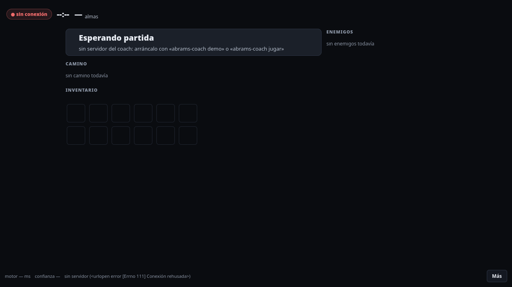

<div align="center">

# Abrams Coach

**A second-monitor coach for Deadlock.** It reads your HUD from the screen, decides what to buy next, and tells you which rule cost you the game.

[](https://github.com/DiegoCraft26/abrams-coach/actions/workflows/ci.yml)
[](CHANGELOG.md)
[](LICENSE)
[](https://www.python.org/)
[](#platforms)

[Español](README.es.md) · [Docs](docs/) · [Roadmap](ROADMAP.md) · [Changelog](CHANGELOG.md)

</div>



<sub>Demo mode (`abrams-coach demo`) with sample data. The panel is the same one you get in a match; the header says `en vivo` (live) or `pantalla` (screen) and enemy souls come from the broadcast.</sub>

## What it is

- **Reads your screen, not the game.** Capture goes through KWin (D-Bus) and OCR. No memory reads, no injection, no hooks, no macros, no overlay inside Deadlock.
- **Tells you the next step,** not a score: a build path with `BUY / SAVE / SELL`, how much you're short, and an ETA in seconds.
- **Warns you at six deaths** — one of the two rules with a demonstrated effect on winning.
- **Writes the post-game note:** which rule you missed, with the population behind it and your own history.
- **Runs on a second monitor or in your browser** (`http://127.0.0.1:8090/panel`), and you can close it without leaving anything behind.

## Quick start

```bash
git clone https://github.com/DiegoCraft26/abrams-coach.git
cd abrams-coach
./instalar.sh          # checks dependencies, no sudo, no package installs
abrams-coach demo      # panel with sample data, without opening the game
abrams-coach listo     # pre-flight: account, network, capture, overlay, disk
abrams-coach jugar     # opens the coach and the panel for a real match
```

`abrams-coach ayuda` prints the whole session cycle in one screen: `listo` → `plan` → `jugar` → `nota` → `sesion`.

## What the panel shows

| Section | Content |
|---|---|
| Header | clock, unspent gold, net worth, soul lead, tactical state |
| Purchase | next step of the build with `BUY / SAVE / SELL`, how much is missing, ETA |
| Inventory | your 12 slots and each item's performance against what was expected |
| Enemies | souls and KDA of the five opponents |
| Plan | the purchases that usually follow, from the public match graph |
| Against their comp | items their threat level justifies, with its source |
| Sales | when selling beats saving |
| Footer | measured latency of every link in the chain |

## How it works

1. **Capture** the screen through KWin and reuse the last frame across readers.
2. **Read** clock, gold and match id from the HUD with OCR; the scoreboard, with templates taken from the game itself.
3. **Attach** to the public broadcast through `deadlock-api`, using the id from the HUD or your account.
4. **Decide** along a build path: three 800 openings, three core pieces (1,600–3,200), then the spikes.
5. **Publish** state on `127.0.0.1:8090`; the native panel and the web panel consume it.
6. **Look up** what it already knows: your own matches for the path, a local archive of public matches for compositions.

Details: [docs/ARQUITECTURA.md](docs/ARQUITECTURA.md) · What it does and doesn't do with the game: [POLITICA.md](POLITICA.md)

## Measured, not assumed

The distinguishing feature of this project is what it **refuses** to claim. Two rules have a demonstrated effect; everything else is reported as what it is.

| Claim | Evidence | Status |
|---|---|---|
| Six deaths or fewer wins more | 76.9% vs 36.2% in 3,538 matches | **used** |
| 0.40 participation or more wins more | 70.9% vs 12.8% in 3,538 matches | **used** |
| The 3,200 item is a target | 55.1% vs 53.0% (p=0.20) in 3,935 player-matches | reported, not recommended |
| Item ranking by "measured value" | 63,680 purchases across 20 patches, no item replicated | **off** — negative result |
| Enemy souls from the broadcast | arrives 20–25 s late, shown with its age | displayed, never hidden |

Write-ups: [docs/MOTOR-V2.md](docs/MOTOR-V2.md) · [docs/VALIDACION.md](docs/VALIDACION.md)

## deadlock-api usage

The coach is a well-behaved client of the public [Deadlock API](https://deadlock-api.com). What it asks for, and how often:

| Call | Budget | How the coach stays inside it |
|---|---|---|
| `GET /v1/matches/{id}/live/url` (spectate **your** match) | 6/hour per IP | one call per match, URL cached 1 h, local token bucket that stops *before* spending |
| `GET /v1/matches/live/urls` (broadcast listing) | unlimited | refreshed every 30 s; matches listed there resolve **for free** |
| `GET /v1/analytics/*` | 200/minute per IP | 24 h disk cache, 120 requests/hour self-imposed ceiling |
| `GET /v1/assets/*` | free | cached for 24 h |
| `POST /v1/matches/demo/query` | 200/hour per IP | own hourly bucket of 170, polls every 5–15 s |

Every request carries one identifying `User-Agent` with a contact link, so their operators can tell our traffic apart from noise.

## Platforms

| System | Status |
|---|---|
| KDE Plasma 6 + Wayland | **tested** (development environment) |
| KDE Plasma + X11 | untested; capture uses KWin over D-Bus and should work |
| GNOME / other desktops | **does not work**: no KWin / `org.kde.KWin.ScreenShot2` |
| Windows | overlay and capture run under Wine (10 checks, GDI capture at 27.7 ms); no native support yet |

The KDE requirement is real: capture goes through `org.kde.KWin.ScreenShot2` (~40 ms per frame, no stutter), with `spectacle` as fallback.

## Requirements

Python 3.11+, GTK 4 with PyGObject, Pillow, NumPy, PyYAML, `tesseract` and `spectacle`.

```bash
# Arch / CachyOS / Manjaro (tested)
sudo pacman -S --needed python-gobject gtk4 tesseract spectacle python-pillow python-numpy python-yaml

# Debian / Ubuntu
sudo apt install python3-gi gir1.2-gtk-4.0 libgtk-4-1 tesseract-ocr spectacle python3-pil python3-numpy python3-yaml
```

Game art is not distributed: on first run the app fetches ~9 MB of icons from the public `deadlock-api` bucket into `data/iconos/` (git-ignored). Code is MIT; Deadlock is a Valve trademark and this project is not affiliated with or endorsed by Valve.

## Docs

| | |
|---|---|
| [docs/GUIA.md](docs/GUIA.md) | user guide |
| [docs/ARQUITECTURA.md](docs/ARQUITECTURA.md) | how the pieces fit |
| [docs/USO-DIARIO.md](docs/USO-DIARIO.md) | the daily cycle |
| [docs/DATOS-DEL-JUEGO.md](docs/DATOS-DEL-JUEGO.md) | what the game exposes and what it doesn't |
| [docs/WINDOWS.md](docs/WINDOWS.md) | the Wine path |
| [ROADMAP.md](ROADMAP.md) | what's next, and what is explicitly not |
| [CONTRIBUTING.md](CONTRIBUTING.md) | how to run the tests |

## Development

```bash
python3 -m compileall -q coach herramientas tests run.py panel_nativo.py
python3 -m pytest -q
python3 coach/iconos.py                                   # fetch game art (once)
python3 herramientas/validar_camino.py --cache data/replay_muestra.json --partidas 60
```

CI runs on Ubuntu 24.04 with GTK under Xvfb, on Python 3.12 and 3.13: it downloads the icons, runs the full suite and the paint gate for the UI. Locally: 510+ tests, and the tests that need local data say so instead of failing silently.

## Privacy

Pixels only. No process memory, no injection, no macros, no telemetry. Captures and the match database stay on your machine (`salida/`, `datos/`). The API only ever receives a match id or your SteamID64.
